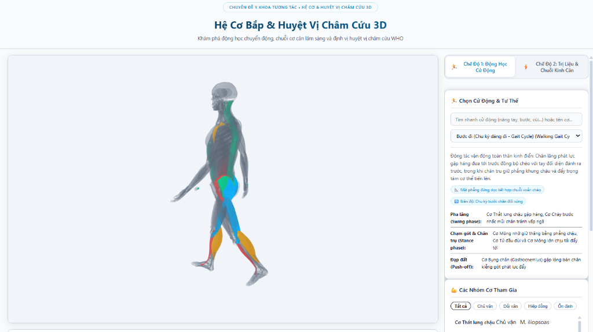
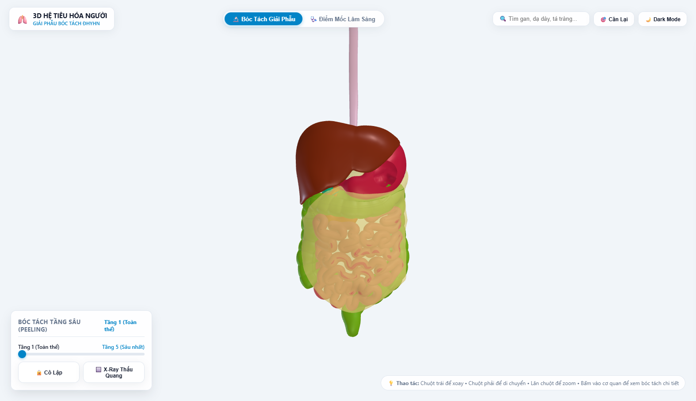

# HMH

Bioinformatics research and interactive web application projects.

---

## Bioinformatic analyses

Where bioinformatics and clinical genomics works are maintained.

<table>
  <tr>
    <td width="50%" valign="top">
      <h3><a href="https://github.com/hmh-215/limb_deformities">limb_deformities</a> </h3>
      
Investigating congenital limb deformities in human patients through whole-genome sequencing (WGS) and variant prioritization.

    </td>
    <td width="50%" valign="top">
      <h3><a href="https://github.com/hmh-215/PA445">PA445</a> </h3>
      
WGS and genomic characterization of <i>P. aeruginosa</i> isolate PA445 carrying dual blaNDM-1 copies.

    </td>
  </tr>
  <tr>
    <td width="50%" valign="top">
      <h3><a href="https://github.com/hmh-215/CRE_phages">CRE_phages</a> </h3>
      
WGS on carbapenem-resistant Enterobacteriaceae (CRE) and targeting phages genomes.

    </td>
    <td width="50%" valign="top">
      <!-- Empty slot for future bioinformatics analysis -->
    </td>
  </tr>
</table>

> [!NOTE]
> **Access to Private Projects**  
> Repositories tagged with `private` contain clinical data and ongoing research. If you are interested in reviewing the methodology, gaining access, or collaborating on these private projects, please get in touch:
> - Email: [hmhuongwm@gmail.com](mailto:hmhuongwm@gmail.com)
> - GitHub: [@hmh-215](https://github.com/hmh-215)

---

## Vibe-coding

Side projects and interactive web applications built through vibe-coding.

<table>
  <tr>
    <td width="50%" valign="top">
      
      <h3><a href="https://github.com/hmh-215/Acupuncture">acupuncture</a></h3>
      
Interactive 3D visualization of acupuncture meridians, acupoints, and muscle movement kinematics.

    </td>
    <td width="50%" valign="top">
      
      <h3><a href="https://github.com/hmh-215/guitar_fretboard_visualization">guitar_fretboard_visualization</a></h3>
      
Interactive guitar fretboard visualizer for notes, scales, chord voicings, and accompanying backing tracks.

    </td>
  </tr>
  <tr>
    <td width="50%" valign="top">
      
      <h3><a href="https://github.com/hmh-215/iching">iching</a></h3>
      
Interactive web application for I Ching (Kinh Dich) hexagram casting, transformation analysis, and philosophical lookups.

    </td>
    <td width="50%" valign="top">
      
      <h3><a href="https://github.com/hmh-215/ChemOrbital_3D">ChemOrbital_3D</a></h3>
      
Interactive 3D general chemistry orbital visualizer for atomic and hybrid orbitals, phase signs, nodal planes, and pi-bonding.

    </td>
  </tr>
  <tr>
    <td width="50%" valign="top">
      
      <h3><a href="https://github.com/hmh-215/human-digestive-anatomy-3d">human-digestive-anatomy-3d</a></h3>
      
Interactive 3D web application for human digestive system anatomy and surgical dissection with concentric histological layers.

    </td>
    <td width="50%" valign="top">
      <!-- Empty slot for future vibe coding project -->
    </td>
  </tr>
</table>

---

## Contact

- Email: [hmhuongwm@gmail.com](mailto:hmhuongwm@gmail.com)
- GitHub: [@hmh-215](https://github.com/hmh-215)
