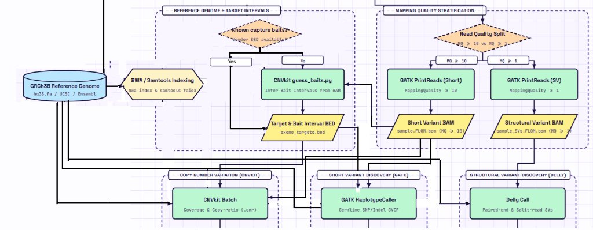
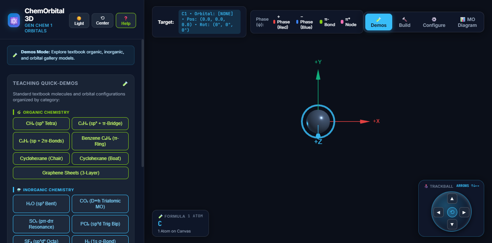
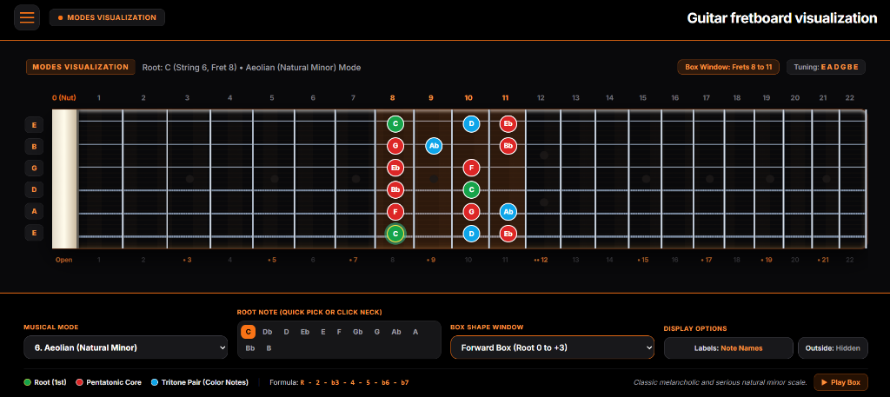
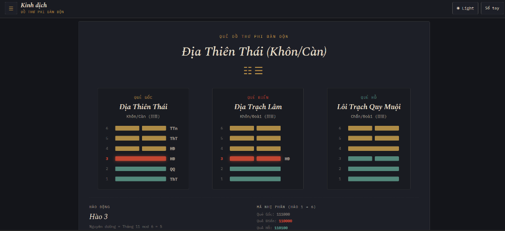

> [!NOTE]
> **Access to Private Projects**  
> Repositories tagged with `private` are not open for publicity. If you are interested in reviewing the methodology, gaining access, or collaborating on these private projects, please get in touch:
> - Email: [hmhuongwm@gmail.com](mailto:hmhuongwm@gmail.com)
> - GitHub: [@hmh-215](https://github.com/hmh-215)

---

# Bioinformatic analyses

My workflows can be described as in [here](https://hmh-bioinforflowchart.vercel.app)

<table>
  <tr>
    <td width="33.33%" valign="top">
      <h4><a href="https://github.com/hmh-215/limb_deformities">limb_deformities</a> </h4>
      
<small>Investigating congenital limb deformities in human patients through whole-genome sequencing (WGS) and variant prioritization.</small>

    </td>
    <td width="33.33%" valign="top">
      <h4><a href="https://github.com/hmh-215/PA445">PA445</a> </h4>
      
<small>WGS and genomic characterization of <i>P. aeruginosa</i> isolate PA445 carrying dual blaNDM-1 copies.</small>

    </td>
    <td width="33.33%" valign="top">
      <h4><a href="https://github.com/hmh-215/CRE_phages">CRE_phages</a> </h4>
      
<small>WGS on carbapenem-resistant Enterobacteriaceae (CRE) and targeting phages genomes.</small>

    </td>
  </tr>
  <tr>
    <td width="33.33%" valign="top">
      <h4><a href="https://github.com/hmh-215/Bpseudomallei">Bpseudomallei</a> </h4>
      
<small>Genomic characterization of 6 <i>B. pseudomallei</i> clinical isolates covering MGEs, prophages, and virulence determinants.</small>

    </td>
    <td width="33.33%" valign="top">
      <!-- Empty slot for future bioinformatics analysis -->
    </td>
    <td width="33.33%" valign="top">
      <!-- Empty slot for future bioinformatics analysis -->
    </td>
  </tr>
</table>

---

# Vibe-coding

Side projects and interactive web applications built through vibe-coding.

<table>
  <tr>
    <td width="33.33%" valign="top">
      
      <h4><a href="https://github.com/hmh-215/Bioinformatics_flowchart">Bioinformatics_flowchart</a> </h4>
      
<small>FlowDeck: Interactive ISO-5807 bioinformatic pipeline flowchart explorer with tool syntax and CLI help manuals.</small>

    </td>
    <td width="33.33%" valign="top">
      
      <h4><a href="https://github.com/hmh-215/ChemOrbital_3D">ChemOrbital_3D</a> </h4>
      
<small>Interactive 3D general chemistry orbital visualizer for atomic and hybrid orbitals, phase signs, and nodal planes.</small>

    </td>
    <td width="33.33%" valign="top">
      
      <h4><a href="https://github.com/hmh-215/guitar_fretboard_visualization">guitar_fretboard_visualization</a> </h4>
      
<small>Interactive guitar fretboard visualizer for notes, scales, chord voicings, and accompanying backing tracks.</small>

    </td>
  </tr>
  <tr>
    <td width="33.33%" valign="top">
      
      <h4><a href="https://github.com/hmh-215/Acupuncture">acupuncture</a> </h4>
      
<small>Interactive 3D visualization of acupuncture meridians, acupoints, and muscle movement kinematics.</small>

    </td>
    <td width="33.33%" valign="top">
      
      <h4><a href="https://github.com/hmh-215/human-digestive-anatomy-3d">human-digestive-anatomy-3d</a> </h4>
      
<small>Interactive 3D web application for human digestive system anatomy and concentric histological layers.</small>

    </td>
    <td width="33.33%" valign="top">
      
      <h4><a href="https://github.com/hmh-215/iching">iching</a>  </h4>
      
<small>Interactive web application for I Ching (Kinh Dich) hexagram casting, transformation analysis, and philosophical lookups.</small>

    </td>
  </tr>
</table>

---

## Contact

- Email: [hmhuongwm@gmail.com](mailto:hmhuongwm@gmail.com)
- GitHub: [@hmh-215](https://github.com/hmh-215)
